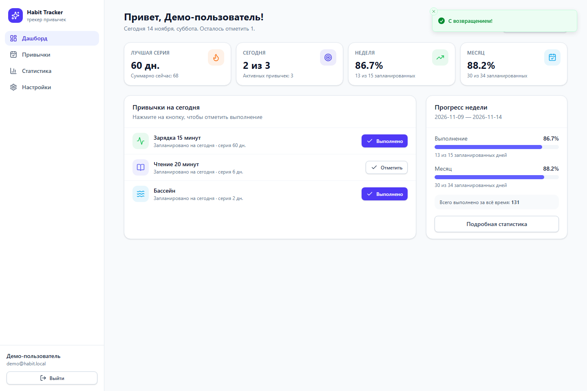
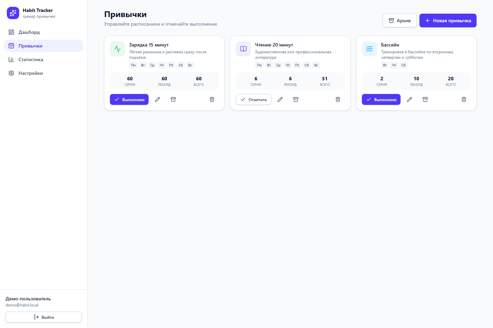
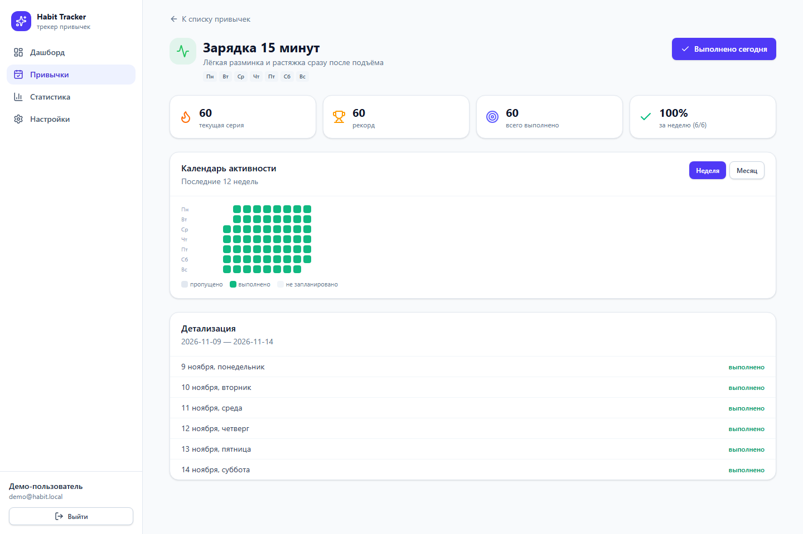
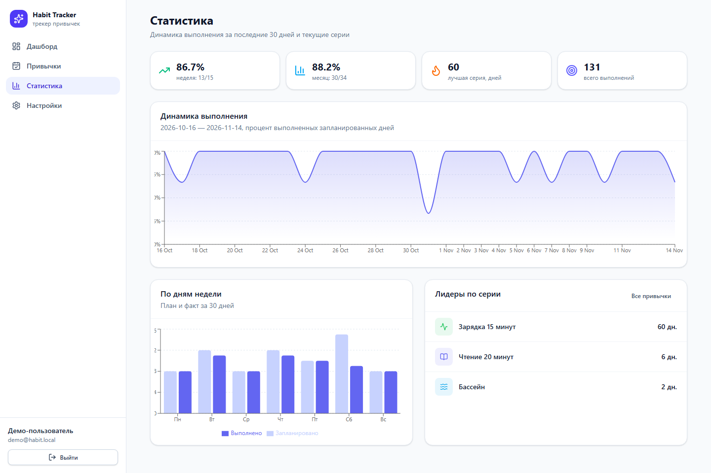
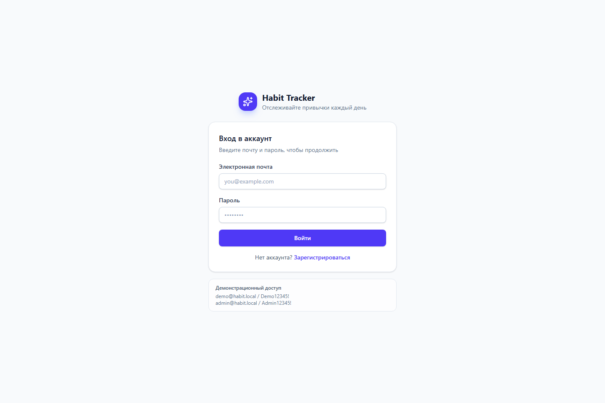
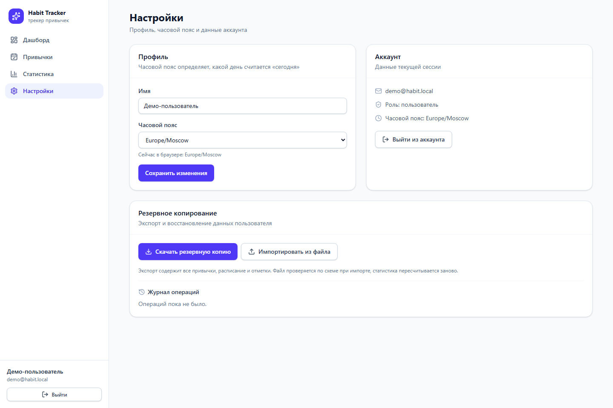

# Habit Tracker — трекер привычек

[](https://github.com/w1nlerrr/Habbit-Tracker/actions/workflows/ci.yml)


Учебный проект по специальности **09.02.07 «Информационные системы и программирование»**.

Полноценное веб-приложение для отслеживания привычек: список привычек с расписанием,
ежедневные отметки, текущая и максимальная серия дней подряд, календарь активности,
статистика за неделю и месяц, резервное копирование и восстановление данных.

## Скриншоты

| Дашборд | Привычки |
|---|---|
|  |  |

| Календарь привычки | Статистика |
|---|---|
|  |  |

<details>
<summary>Вход и настройки</summary>





</details>


## Стек

| Слой | Технологии |
|---|---|
| Frontend | React 19, TypeScript, Vite, TanStack Query, React Hook Form, Tailwind CSS, Recharts |
| Backend | Node.js 24, Express 5, TypeScript, Prisma 7, Zod, pino |
| База данных | PostgreSQL 18: роли и права, представления, триггеры, `pg_dump` / `pg_restore` |
| Тесты | Vitest (28 unit-тестов доменной логики) |
| Инфраструктура | npm workspaces, Caddy (HTTPS), PM2, Планировщик заданий Windows |

## Требования

- **Node.js 24+**
- **PostgreSQL 16+** (проверено на 18.6), запущенный локально на порту 5432
- Права суперпользователя PostgreSQL — нужны **один раз** для создания базы и ролей

## Быстрый старт (для другого компьютера)

1. Установите **Node.js 24+** и **PostgreSQL 16+** (запущенный локально на порту 5432).
2. Скачайте проект (git clone или ZIP) и запустите:

```bat
start.bat
```

При **первом запуске** скрипт сам:
- найдёт PostgreSQL (PATH, служба, реестр, стандартные каталоги);
- спросит имя и пароль суперпользователя PostgreSQL (нужны один раз, чтобы создать базу и роли);
- сгенерирует `.env` со случайными паролями ролей и JWT-секретами;
- создаст базу `habit_tracker` и роли `ht_owner` / `ht_app` / `ht_readonly` / `ht_backup`;
- установит зависимости, соберёт проект, применит миграции и загрузит демо-данные.

При **последующих запусках** `start.bat` просто проверяет сборку, применяет миграции,
запускает сервер и открывает браузер: **http://localhost:3000**.

Остановка — `Ctrl+C` в окне консоли.

### Демонстрационные учётные записи

| Почта | Пароль | Роль |
|---|---|---|
| `demo@habit.local` | `Demo12345!` | пользователь |
| `admin@habit.local` | `Admin12345!` | администратор |

## Режим разработки

```bat
dev.bat
```

Откроются два окна: API (`http://127.0.0.1:3000`) и Vite (`http://127.0.0.1:5173`)
с горячей перезагрузкой и проксированием `/api` на сервер.

Либо вручную:

```powershell
npm install
npm run build:shared
npm run dev:server        # терминал 1
npm run dev:client        # терминал 2
```

## Полезные команды

| Команда | Назначение |
|---|---|
| `npm run build` | сборка shared + server + client |
| `npm run test` | unit-тесты доменной логики |
| `npm run typecheck` | проверка типов всех пакетов |
| `npm run db:migrate` | миграции Prisma (dev) |
| `npm run db:deploy -w @habit/server` | применение миграций (без shadow DB) |
| `npm run db:seed` | демонстрационные данные |
| `npm run db:studio -w @habit/server` | Prisma Studio |
| `scripts\backup.ps1` | резервная копия БД (`pg_dump` + SHA-256 + ротация) |
| `scripts\restore.ps1 -File <dump>` | восстановление БД с проверкой контрольной суммы |
| `scripts\setup-db.ps1` | создание базы и ролей PostgreSQL (вызывается из bootstrap) |
| `scripts\bootstrap.ps1` | полная автонастройка при первом запуске |

## Структура репозитория

```
apps/server        REST API: presentation → application → domain → infrastructure
apps/client        SPA на React
packages/shared    общие DTO и Zod-схемы (единый контракт клиента и сервера)
docs/              архитектура, БД, API, развёртывание, безопасность, резервное копирование
ops/               конфигурация PostgreSQL и каталог логов
scripts/           автонастройка БД, резервное копирование и восстановление
start.bat          запуск приложения одним файлом (с автонастройкой при первом запуске)
dev.bat            запуск в режиме разработки
```

## Документация

- `docs/04-security-hardening.md` — усиление защиты PostgreSQL (scram-sha-256, localhost)
- `docs/04-deployment.md` — развёртывание и запуск на локальном компьютере
- `docs/05-backup-restore.md` — регламент резервного копирования и восстановления
- `docs/06-github.md` — публикация проекта, релизы и CI
- `docs/07-modules-mapping.md` — соответствие учебным модулям (ПМ02, ПМ04, ПМ11)

## Безопасность

- Argon2id для паролей, JWT access-токен 15 минут, refresh-токен в `httpOnly` cookie
  с ротацией и хешированием в БД;
- роли PostgreSQL с минимальными правами (`ht_app` не может менять схему);
- `helmet`, rate-limit, CORS-whitelist, валидация всех входных данных через Zod;
- журнал действий `audit_log`, журнал бэкапов `backup_jobs`;
- секреты — только в `.env`, файл исключён из git.

