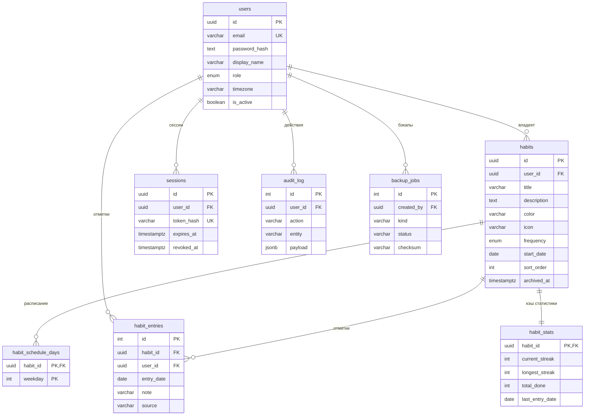

# База данных

## 1. ER-диаграмма

## 2. Таблицы и ограничения

| Таблица | Назначение | Ключевые ограничения |
|---|---|---|
| `users` | пользователи | `UNIQUE(email)`, длина имени |
| `habits` | привычки | `CHECK` названия и цвета, частичный `UNIQUE(user_id, lower(title)) WHERE archived_at IS NULL` |
| `habit_schedule_days` | дни недели | `PK(habit_id, weekday)`, `CHECK(weekday 1..7)` |
| `habit_entries` | отметки | `UNIQUE(habit_id, entry_date)`, `CHECK(source)`, индексы по датам |
| `habit_stats` | кэш агрегатов | `CHECK(значения >= 0)` |
| `sessions` | refresh-сессии | `UNIQUE(token_hash)`, `CHECK(expires_at > created_at)` |
| `audit_log` | журнал действий | `payload` в jsonb, индексы по времени |
| `backup_jobs` | журнал бэкапов | `CHECK(size_bytes >= 0)` |

## 3. Объекты БД (миграция `db_objects`)

| Объект | Тип | Назначение |
|---|---|---|
| `v_habit_daily_status` | VIEW | план/факт по каждому дню |
| `v_habit_week_stats` | VIEW | недельные агрегаты и процент |
| `v_habit_month_stats` | VIEW | месячные агрегаты |
| `v_user_day_totals` | VIEW | данные для календаря активности |
| `v_habit_overview` | VIEW | активные привычки с агрегатами |
| `fn_touch_updated_at` | триггер | обновление `updated_at` |
| `fn_audit_habit` | триггер | аудит изменений привычек |
| `fn_validate_entry` | триггер | владелец, даты, архив |
| `fn_entry_immutable` | триггер | запрет менять привычку/дату отметки |
| 10 CHECK, 2 частичных индекса | ограничения | целостность на уровне БД |

## 4. Роли и права

| Роль | Права | Использование |
|---|---|---|
| `ht_owner` | владелец схемы, миграции | `prisma migrate` |
| `ht_app` | `SELECT/INSERT/UPDATE/DELETE`, без DDL | API-сервер |
| `ht_readonly` | `SELECT` только на VIEW | отчётность |
| `ht_backup` | `pg_read_all_data` | `pg_dump` |

Проверка: `ht_app` не может создать таблицу; `ht_readonly` не видит таблицы напрямую.

## 5. Резервное копирование

- `scripts/backup.ps1` — `pg_dump -Fc` + SHA-256 + ротация;
- `scripts/restore.ps1` — проверка суммы, `pg_restore --clean`, smoke-check;
- журнал операций — таблица `backup_jobs` (виден в «Настройках»).

Подробно: `docs/05-backup-restore.md`.
